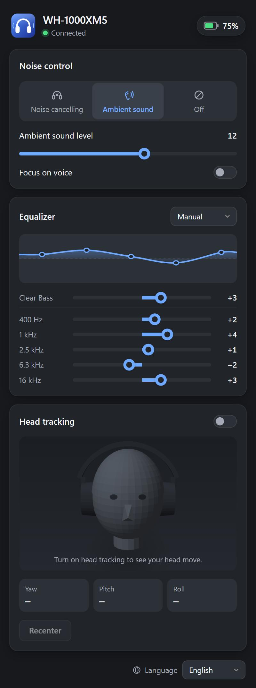

# XM Control: Sony WH-1000XM4 / XM5 / XM6 app for Windows PC

**A free Windows app to control Sony WH-1000XM4, WH-1000XM5 and WH-1000XM6 headphones from your PC or
laptop**: switch noise cancelling and ambient sound, set the ambient level, adjust the equalizer (EQ) and
Clear Bass, check the battery, and see head tracking live. It is a desktop alternative to Sony's phone apps
(Sony | Headphones Connect / Sound Connect), which have no Windows version. Works on Windows 10 and 11 over
Bluetooth, while music is playing.

**免費的 Windows 電腦版 Sony 耳機控制軟體**：在電腦上切換 WH-1000XM4 / XM5 / XM6 的降噪、環境音，調整等化器（EQ），
查看電量。不用打開手機的 Sony | Headphones Connect / Sound Connect App。[繁體中文說明在下面](#繁體中文)

<p align="center">
  
</p>

**[⬇ Download for Windows](../../releases/latest)** (installer or portable zip, no Python needed)

| | WH-1000XM4 | WH-1000XM5 | WH-1000XM6 |
|---|---|---|---|
| Battery | ✓ | ✓ | ✓ |
| Noise cancelling / ambient sound / off, ambient level, focus on voice | ✓ | ✓ | ✓ |
| Wind noise reduction | ✓ | | |
| Automatic ambient level | | | ✓ |
| Equalizer: presets and custom bands | 5 bands + Clear Bass | 5 bands + Clear Bass | 10 bands |
| Head tracking (live 3D view) | | ✓ | ✓ |
| **Tested on real headphones** | **not yet** | **yes** | **yes** (reported by a user) |

The XM4 and XM6 support follows what other open-source projects found (see [PROTOCOL.md](PROTOCOL.md) §11).
A user has confirmed the XM6 works; the XM4 has not been tried on real headphones yet. If you own one, please
[open an issue](../../issues) with what works and what does not.

This is an unofficial project. It is not made by, endorsed by or affiliated with Sony.

## Download and run

No Python needed. From the [latest release](../../releases/latest), download either:

- `XM-Control-…-setup.exe`: installer for your user account (no administrator rights needed), with a Start menu
  shortcut and an optional desktop shortcut.
- `XM-Control-…-windows.zip`: portable; unzip anywhere and run `XM Control.exe`.

The app is not code-signed, so Windows SmartScreen may say "Windows protected your PC". Click
**More info → Run anyway**.

Requirements: Windows 10 or 11 with Bluetooth, the headphones paired in Windows Settings, and Microsoft Edge
(already part of Windows) for the app window.

## Using the app

- The window shows the connected headphones, their battery, noise control, equalizer and head tracking. It finds
  the headphones by their Bluetooth name; if several supported headphones are paired, it uses the one that is
  connected.
- Closing the window keeps the app in the system tray. Click the icon to bring the window back; right-click it to
  switch noise control or quit.
- Only one program at a time can talk to the headphones' controls: quit the app before using the command line.
- Head tracking needs a one-time Windows repair the first time (the app offers it; it asks for administrator
  rights).

## Command line

The release includes `sonyxm.exe` next to `XM Control.exe`:

```
sonyxm battery
sonyxm status                 # noise control; --watch keeps listening
sonyxm nc on | off | wind     # wind: WH-1000XM4 only
sonyxm ambient 12 --voice     # ambient sound, level 1-20, focus on voice; --auto on the WH-1000XM6
sonyxm eq                     # show the equalizer
sonyxm eq preset bass_boost
sonyxm eq bands 2 0 -1 3 4 --clear-bass 1   # 10 values on the WH-1000XM6
sonyxm head                   # live head tracking angles; --repair sets up the sensor
sonyxm devices                # paired Bluetooth devices
sonyxm connect                # handshake only: shows the model and protocol
```

Add `--debug` to any command to see every byte sent and received; please include that output in bug reports.
`--address AA:BB:CC:DD:EE:FF` picks headphones by address.

## Safety

The tool only ever sends the handful of commands listed in [PROTOCOL.md](PROTOCOL.md) §7: a whitelist checked
for every frame, separately for each protocol version. Firmware update, factory reset, reboot, power off and
pairing commands can never be sent.

## Running from source

Python 3.11 or newer on Windows; no other packages.

```
python -m sonyxm gui          # the app window
python -m sonyxm status       # any command
python -m unittest            # the tests (no headphones needed)
```

To build the release files: `python -m pip install pyinstaller`, then `.\packaging\build.ps1` (and Inno Setup
for the installer, see `packaging\installer.iss`). Pushing a `v*` tag builds and publishes a release on GitHub.

## How it works

The headphones offer Sony's control protocol over a Bluetooth RFCOMM channel next to the audio connection.
[PROTOCOL.md](PROTOCOL.md) documents every byte this project uses, with its source. Many thanks to the projects
it learned from: [Gadgetbridge](https://codeberg.org/Freeyourgadget/Gadgetbridge),
[mos9527/SonyHeadphonesClient](https://github.com/mos9527/SonyHeadphonesClient),
[Plutoberth/SonyHeadphonesClient](https://github.com/Plutoberth/SonyHeadphonesClient) and, for head tracking,
[NicholasSlattery/sony-head-tracker](https://github.com/NicholasSlattery/sony-head-tracker). No code was copied
from them.

## License

[MIT](LICENSE)

---

## 繁體中文

**XM Control：Sony WH-1000XM4 / XM5 / XM6 的 Windows 電腦版控制程式。** Sony 的 Headphones Connect / Sound Connect
只有手機版，這個免費開源軟體讓你在 Windows 10 / 11 的電腦或筆電上，直接切換耳機的降噪、環境音（含強度與專注於人聲），
調整等化器（EQ）與 Clear Bass，查看電量，還能即時顯示頭部追蹤。有視窗介面、系統匣圖示，也有指令列工具；
播放音樂時也能使用。

- **下載**：到 [Releases](../../releases/latest) 下載 `XM-Control-…-setup.exe`（安裝檔，不需系統管理員權限）或
  `XM-Control-…-windows.zip`（免安裝，解壓後執行 `XM Control.exe`）。不需要安裝 Python。
- 程式沒有數位簽章，Windows 可能顯示「Windows 已保護您的電腦」，請按「**其他資訊 → 仍要執行**」。
- 先在 Windows 設定中配對耳機。程式會依藍牙名稱自動認出型號；配對了多副時，使用目前連線中的那一副。
- 關閉視窗後程式會留在右下角系統匣：點圖示叫回視窗，按右鍵可切換降噪模式或結束。
- 已在 **WH-1000XM5** 實機測試，**XM6** 有使用者回報可以使用；**XM4 尚未實機測試**（依其他開源專案的資料實作），
  歡迎[開 issue](../../issues) 回報結果，最好附上 `sonyxm status --debug` 的輸出。
- 只會送出白名單內的指令，絕不會送出韌體更新、恢復原廠、重新開機、關機或配對相關的指令。
- 本專案為非官方專案，與 Sony 無關。
